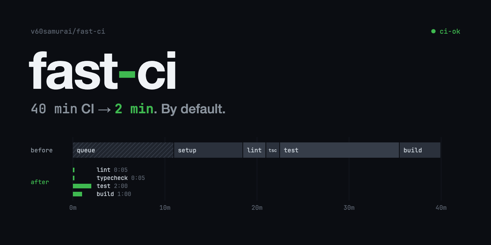

# fast-ci

A Claude Code skill that gives every repo fast CI and a pre-push hook by default. A SessionStart hook checks for a `.ci-baseline` file at the repo root. When it is missing, the hook tells the agent to run fast-ci setup before any other work, so a new repo, or the next session in an old one, gets the baseline without anyone asking.

The techniques come from Owen Gretzinger (head of engineering at Boardy), who took CI from 40 minutes to 2 per PR. Coding agents now write every PR and wait on CI after every push, so CI time is the length of their loop.

## What a repo gets

- `.github/workflows/ci.yml`. Lint, typecheck, build and tests run as parallel jobs. Main seeds the dependency cache that PRs restore, `node_modules` is cached, checkout is blobless, and Vitest runs only affected tests on PRs and the full suite nightly. A single `ci-ok` job is the required check, and it fails when a code change ran no tests. Paid runners are commented out.
- `lefthook.yml`. A pre-push hook that runs format, lint and typecheck on the pushed files: Oxfmt, Oxlint and `tsc` for TS/JS, and Ruff and ty for Python.
- `.ci-baseline`. The skill version, the date and the detected stack.

[`SKILL.md`](SKILL.md) holds the setup steps, the changes that need your approval, and the audit for a repo whose CI is already slow. When CI or a hook already exists, `setup.sh` leaves it alone, prints a diff and writes its proposal to `.fast-ci-proposed/` for the agent to merge.

## Install on a new machine

```bash
git clone https://github.com/v60samurai/fast-ci.git ~/src/fast-ci
ln -s ~/src/fast-ci ~/.claude/skills/fast-ci
```

Then apply the two snippets by hand:

1. Merge [`snippets/settings.json`](snippets/settings.json) into `~/.claude/settings.json`. If `hooks.SessionStart` already exists, add the entry to its array.
2. Add the line in [`snippets/CLAUDE.md`](snippets/CLAUDE.md) to `~/.claude/CLAUDE.md`.

JS repos get lefthook as a dev dependency. For Python repos, `setup.sh` installs lefthook with Homebrew when it is not already installed.

Check the install from any Git repo without a `.ci-baseline`:

```bash
bash ~/.claude/skills/fast-ci/hooks/session-start.sh
```

It prints the instruction. It prints nothing outside a Git repo or in a repo that has the baseline.

## Check that the hook fires inside T3 Code

T3 Code starts Claude sessions itself, so whether it loads hooks from `~/.claude/settings.json` depends on how it starts them.

1. Make a scratch repo with no baseline: `mkdir /tmp/t3-hook && cd /tmp/t3-hook && git init`.
2. Open it as a project in T3 Code and start a thread with a Claude model.
3. Send: `Quote any SessionStart hook context you received, word for word, or say NONE.`

The reply should quote `This repo has no .ci-baseline. ...`. If it says NONE, that T3 Code build does not run user hooks for Claude sessions, and a repo opened there gets no baseline until the next plain Claude Code session. Codex threads read Codex's own config and never see this hook.

## Proof

```bash
bash tests/run.sh
```

It builds a throwaway Bun + TypeScript + Vitest repo with a local bare remote and deletes it on exit. It checks that the first session gets the hook message and runs setup on its own, that setup writes the workflow, `lefthook.yml`, the Git hook and the marker, that a second setup run changes nothing, that a push with a type error is blocked locally, and that a second session gets no message. It needs `bun`, `claude`, `jq` and network access. `MODEL=haiku` makes it cheaper.

## Values to tune

The templates ship working defaults marked `TODO(fast-ci)`. Set them from measured runs: `grep -rn 'TODO(fast-ci)' templates/`.
